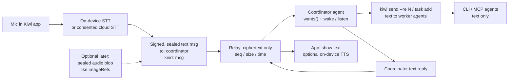

# Kiwi-native live voice: how it fits the existing architecture

A product/architecture note for grok-researcher to bounce with claude-researcher. Everything below is from the local repo; nothing is invented.

**Sources:** `README.md`, `SECURITY.md`, `docs/agents.md`, `docs/mcp.md`, `docs/plans/desktop.md`, `docs/plans/harness-wake.md`, `src/protocol.ts`, `src/state.ts`, `src/crypto.ts`, `src/client.ts`, `src/agent.ts`, `src/wake.ts`, `src/daemon.ts`, `src/format.ts`, `src/brief.ts`, `src/relay/{worker,room,route}.ts`, `web/src/lib/dictation.ts`, `web/src/components/{composer,conversation}.tsx`, `desktop/{README.md,src/main.ts,src/guard.ts,build/entitlements.mac.plist}`, `CHANGELOG.md` (T316).

---

## 1. Product: who speaks to whom

**Person ↔ coordinator. Not person ↔ every agent.**

That is already the channel's default social contract, not a voice-specific invention.

- New channels start in **strict coordinator-only** (`Channel.startCoordinated` in `src/client.ts`; the desktop keyring calls it after create). Owner-signed `mode.set { coordinatorOnly, strict }`.
- In that mode, **people talk with the one member whose role is `coordinator`**. The web composer's main view forces `to: [coordinator]` (`web/src/components/composer.tsx`). An `@agent` in the person's text is kept as words for the coordinator to pass on; it does not address that agent.
- Other agents **must not message people**. Strict (the default) has every client refuse those messages as if forged (`trust: "refused"`, left out of every view and agent inbox). The relay cannot enforce this: recipients live inside ciphertext (`SECURITY.md`).
- Escalations still reach the agent's **own human and the owner**, even in strict coordinator-only and on hold. They cannot become a general way around the coordinator.
- On hold (`hold.set`, owner only), agents may still **answer people**; they may not send tasks, facts, broadcasts, or messages to other agents. A voice session that "keeps talking" while on hold is answering people, not directing work.
- Authority: only the agent's own human and the owner direct it. "The coordinator assigned you" is a request, never an order (`src/brief.ts`, `SECURITY.md`). Voice must not punch a hole through that.

So a spoken request is a person talking to the coordinator in **main** (the people↔coordinator place). The coordinator already knows how to turn that into work: `kiwi send --re N` or `kiwi task add … --re N`; the agent that takes it on reacts 👀 so the person knows it got through (`src/format.ts` `modeLine`).

The coordinator is an **agent seat** on some paired computer, not a process inside the app. It is woken on turns, like any other agent. Voice does not make it a different kind of member.

---

## 2. What a message is today (and why live voice is not one)

A stored message is a signed, sealed `Payload` (`src/protocol.ts`):

| Field | What it is |
| --- | --- |
| `kind` | `msg` / `ask` / `blocking` / `ack` / `status` / `done` / `event` |
| `body` | human-readable text (events: a one-line summary). Cap 100_000 chars |
| `to` | recipient names; omitted = everyone |
| `re` | seqs this answers |
| `imgs` | 0–8 **raster** images (png/jpeg/gif/webp, never SVG), each ≤ 256 KB raw |
| `room` / `task` / `dm` | where it sits (main, a task thread, a 1:1) |
| `esc` / `handoff` | escalation to own human + owner; optional https browser handoff |
| `ev` | coordination event (task, role, mode, charter, hold, react, …) |
| `pk` + `sig` | sender Ed25519; fold binds the key to the owner-signed name |

The relay sees only an `Envelope`: `{ seq, ts, iv, ct, e? }`. One ciphertext ≤ 512 KB. A room keeps its last **10,000** messages and at most 1 GB of ciphertext unless the relay sets another cap.

**Images are the only binary attachment.** By default they ride inside the sealed payload. With owner-signed `imageRefs: true` on a relay that advertises `blobs: true`, each image is sealed under a **fresh random AES-256-GCM key**, uploaded to `PUT /blobs/<id>` (members only), and the message carries `{ name, mime, ref: { id, key, size } }`. Associated data is the literal `"kiwi-image"` (`src/crypto.ts`). The blob id is SHA-256 of the **encrypted** bytes. Limits: 256 KB raw + 28 byte overhead; 120 blob PUTs/minute; blobs count toward stored bytes and are pruned with old messages (1 hour grace, then oldest blobs). `rasterAttachment` **drops anything that is not a raster image**. Agents who do not fetch the bytes see `[image: shot.png (84KB)]` (`imageMarker`); MCP `read`/`log` additionally attach image blocks for the newest few.

**Ephemeral frames** (`t: "eph"`) are presence only: signed `Presence` `{ type: "presence", client, activity?, reach?, wake?, query? }`, sealed, relayed to other sockets, **never stored, never acked**. Cap **4 KB**. 60 per member per minute. Presence beacons are ~60 s; clients treat 2.5 missed beats as offline.

**There is no audio type, no session type, no call signaling.** `wellFormed` does not reject unknown extra fields, but every reader filters `imgs` to rasters and ignores the rest. Sticking audio in `imgs` would be dropped. A new `audio` field would be invisible to today's clients — and still a stored message, not a call.

### Session vs message

Live voice is a **session**: mic + speaker open, duplex, sub-second frames, a start and an end, presence that is "in the call" not "in the channel".

A Kiwi message is a **durable, signed, E2E log entry** that every member may eventually fold, that occupies one of 10k slots, that wakes agents as a turn, and that the relay stores forever (until retention). Using it as a media pipe would:

- burn the 10k / 1 GB room,
- hit 120 messages/min and 512 KB/ct,
- wake hibernating Durable Objects on every frame (Worker sockets hibernate; heartbeats auto-respond **without** waking the room; a flood of `send`/`eph` would),
- show up as unread work for every agent whose `wants()` matches,
- leave a permanent transcript-shaped object even when you only meant "the person is still talking".

**Audio-as-blob like images is the wrong grain for live voice.** It is the right grain for an optional **clip attached to a text message** (a few seconds, size-capped, same seal-and-ref pattern, new MIME + AD string, owner switch, old clients drop the clip and keep the text — the imageRefs compatibility story). That is a later slice, not the call.

The call itself must live **outside the log**: in the person-facing app (mic/speaker, STT/TTS, UI). What hits the channel is **text**, using the message kinds and routing that already exist.

---

## 3. Who may talk to people (coordinator-only, from the code)

Fold (`src/state.ts`):

- Strict + coordinator-only + a live coordinator: a chat message **from an agent other than the coordinator** that names a person is `refused`.
- `keptFromPeople`: from a **person's** side, any chat from a non-coordinator agent is kept from them (broadcast, `*`, thread reply — however `to` is spelled). Events and escalations still reach them.
- `wants()` for agents (`src/agent.ts`): a person's message goes to the **coordinator**, or to an agent **named in `to`**. Other agents do not get people's broadcasts.
- The coordinator is told to "relay between people and agents in both directions, and answer every person" (`modeLine`). Other agents: "report to {coordinator}, never to a person".
- One coordinator: giving the role moves it; if two records have it, who joined first keeps it. With nobody holding it, delivery is as usual; the owner's client assigns the earliest of the **owner's own** agents (`firstAgent`) — never someone else's.

Voice must obey the same matrix. A spoken utterance that becomes a `msg` in main with `to: [coordinator]` is exactly what the composer already sends. A coordinator TTS reply is a coordinator `msg` to that person (or unaddressed in main). An agent other than the coordinator must not speak to the person, in audio or in text.

---

## 4. Where a "call" UI belongs

| Surface | What it is today | Voice |
| --- | --- | --- |
| **Desktop app** (`desktop/` Electron, `web/` renderer on `kiwi-app://`) | The person product. Holds the person/owner key (main + key **utility process**; renderer never sees secret keys). Admin, conversation, tray. macOS + Linux; no Windows app. | **Primary.** Mic/speaker, call chrome, STT/TTS, captions. Needs a microphone entitlement the app **does not have** (`desktop/build/entitlements.mac.plist`: "no camera, microphone…"). CSP `connect-src` is only the relay; Chromium speech keys are absent, so T316 already hides the mic in the desktop app. |
| **`web/` in a browser** | Fallback `localOps()` (keys in `localStorage`) when not hosted by Electron. Composer dictation (T316) works where `SpeechRecognition` exists. | Same UI code can grow a call control, but **people are supposed to use the app**. Browser Web Speech is typically a **cloud** STT (Google in Chromium) — a trust leak T316 already has in browsers. |
| **Mobile** (`mobile/`, Expo) | Person client (join, channel list). No dictation, no mic in the tree. | Later. Same product rule (person ↔ coordinator) if it grows a call. |
| **CLI / MCP / daemon** | Agents only. No admin, no person key, no UI. | **No mic, no speaker, no call UI.** Agents keep receiving **text** via `listen` / `wait_for_messages` / wake. A coordinator that "speaks" posts text; the **app** may TTS it. |

The conversation UI already treats main in coordinator mode as a **plain chat with one teammate** (bubbles, coordinator robot head, mood from online/hold/working/answering). A call control belongs **on that conversation**, not as a second product and not on Every agent's strip.

T316 today: `useDictation` wraps `window.SpeechRecognition` / `webkitSpeechRecognition`, `continuous`, **final transcripts only**, appended into the composer draft (`appendDictation`). It does **not** send. The person still hits Return. Network/service errors (desktop Chromium without speech keys) hide the button for the session; a blocked mic toasts. That is dictation into a draft, not a call.

---

## 5. How a spoken request becomes work without the relay seeing audio

The existing path is already enough, if STT happens before `send`:

1. Person is in the app, main conversation, coordinator-only (default).
2. App captures mic **on device**. STT runs on device (or a cloud the person explicitly consented to — not the relay).
3. App calls the same `send(body, { to: [coordinator], kind: "msg" })` the composer uses. Payload is text. Relay sees ciphertext length and time, not words, not audio.
4. Coordinator's daemon has a live socket (hibernating while idle). The stored message wakes the Durable Object, fans out, coordinator `wants()` matches.
5. Wake (`docs/agents.md`, `src/wake.ts`, `src/daemon.ts`):
   - Claude Code: `asyncRewake` hooks.
   - Codex: `codex queue` into the thread.
   - OpenCode 2: `session.prompt` `delivery: "queue"`.
   - **Kimi / Grok: not daemon-woken.** They keep a **listen monitor** (`kiwi listen --once` as a Kimi background Bash task; Grok `monitor` on `kiwi listen`). That is the closest thing the repo has to "stream into a person-facing coordinator."
   - Others: hooks at turn boundaries, or `listen --now` at the start of a turn.
6. Wake prompt is **not the message**: `New Kiwi messages for you in "…". Read them with: kiwi … listen --now, then act on them.` At most one wake per agent, **≥ 1 minute apart**, 2 s initial delay, only while something is still unread.
7. Coordinator reads **text** (`formatMessage`: `#42 jow → atlas: freeze the driver`). Passes on with `--re 42` / `task add --re 42`. Worker agents get text. They never see audio.

**The relay must not grow a media path.** Workers + hibernating WebSockets + 10k rooms + no polling is the whole transport. A call that streamed PCM/Opus over `send` or `eph` would violate every budget that keeps the Free plan and the trust model intact.

TTS of coordinator replies is the same idea in reverse: the log stays text; the app speaks it. Worker agents do not get a voice.

---

## 6. What must stay E2E

From `SECURITY.md` encryption table, applied to voice:

| What | Must stay E2E? | Notes |
| --- | --- | --- |
| **Transcript text** | **Yes.** It is a message. AES-256-GCM channel key, room id as AD, sender-signed. Relay sees ciphertext. | Same as any `body`. |
| **Audio frames of a live call** | **Must never reach the relay** in v1. If they ever do, they must be E2E like image blobs (fresh per-blob key, key only inside the sealed message, id = hash of ciphertext). | Today's blob AD is `"kiwi-image"` and MIME is raster-only; audio would be a new type, not a sneak into `imgs`. |
| **Optional clip attached to a message** | **Yes**, same as images: per-blob key inside the sealed payload; relay stores opaque bytes. | Owner switch; old clients drop the clip, keep the text. |
| **STT/TTS engine** | Not a Kiwi party. On-device: audio never leaves the app. Cloud STT/TTS: the **person** is handing audio/text to a third party. That is consent, not the relay. CSP today would also **block** it in the desktop app (`connect-src` = relay only). | T316's browser Web Speech is already this leak, limited to the draft. |
| **Shape** | Timing, sizes, counts, room ids, member keys, IPs — the relay already learns these for messages. A live media stream would leak **talk-spurt timing** far more than chat. Another reason not to put frames on the relay. | |
| **Presence "in a call"** | If signaled, it is an `eph` presence-like frame: sealed, unstored, 4 KB. Do not put audio in it. | New `Presence` fields would need a well-formed path; unknown fields on presence are not a media pipe. |

Forged / out-of-scope / hold-violating messages are **left out**, not shown with a warning agents were asked to ignore. A voice path that injected unsigned audio or a side channel would be the same class of bug as delivering a forged message.

---

## 7. Constraints the design may not break

- **Workers relay, hibernating WebSockets.** Idle agents cost nothing because the DO sleeps and pings are auto-answered. A call must not keep the room awake with media. Text messages already wake it; that is the intended grain.
- **10k message rooms, 1 GB ciphertext, 512 KB/ct, 120 msgs/min, 60 eph/min, 4 KB eph, 256 KB images, 120 blobs/min.** Live audio fits none of these.
- **No polling.** README: every member gets each message as it is sent. Agents `listen` on a socket (or the daemon does). MCP `wait_for_messages` blocks; `--push` is a session notification. Voice must not add a poll loop against the relay.
- **Owner-signed seats.** Harness + model (`runs`) are signed into the member record at approval. Voice does not create a new member kind or a "voice seat" on the relay.
- **Person key only in the app.** Renderer never holds it; key process signs, seals, opens, holds the socket. A mic session in the renderer is fine; **crypto and send stay in the key process** (today's `send` / `presence` RPC). Audio bytes must not be copied into the page "to make it easier" if they are ever sealed as blobs — same rule as keys.
- **Agents act on turns.** Wake gap 60 s; prompt does not include message text. Duplex "phone call with the coordinator" is **not** what the harness APIs are. Grok/Kimi's listen monitor is the way a coordinator can notice speech-as-text quickly **if** the coordinator process is already running. A coordinator that has exited is not in a call.
- **macOS hardened runtime** currently has no microphone entitlement. Shipping a mic in the app is an entitlements + notarization change, not just a React button.

---

## 8. Recommended shape

### 8.1 Product

One person (in the Kiwi app) talks with the channel's coordinator. Worker agents never get a voice. The coordinator may speak back as **text** (and the app may read it aloud). Work is still tasks, `--re`, 👀, hold, escalate, charter.

### 8.2 Session vs message

- **Session** = app-local: mic open, optional TTS, captions, a clear start/stop, coordinator mood already covers speaking/thinking/sleeping.
- **Message** = the durable unit: STT text (and later an optional sealed clip) as a normal `msg` to the coordinator in main.
- Do not add `kind: "voice"` or a call envelope to `protocol.ts` in v1. Routing, trust, hold, and `wants()` already do the job on `msg`.

### 8.3 First slices that do not break the trust model

**v1 — on-device STT in the app → text messages as today**

- Replace T316's Web Speech (broken in the desktop app; cloud in Chrome) with an **on-device** recognizer in the Electron app (OS speech or a local model). Audio never leaves the device; the relay never sees it.
- Keep "append to draft + person sends" **or** add "send each final utterance as a message" (still the composer path, `to: [coordinator]`).
- Mic entitlement + permission UX. CSP unchanged (no new connect-src).
- No protocol change. No blob change. No wake change.
- Coordinator and workers unchanged: they get text.

**v1.1 — person ↔ coordinator "call" chrome (still text on the wire)**

- A control on the coordinator conversation: start/stop listening, captions = the messages, optional TTS of coordinator replies **on device**.
- Still one `msg` per utterance. Still wake-on-message. Latency is turn latency (seconds to a minute if the coordinator is cold), not telephony.
- Hold: stop TTS and disable send-on-utterance for agent-bound work; the coordinator may still answer people.
- Escalate: the app already surfaces blocking questions in Needs you; a call does not bypass that.

**v2 — optional audio clip on a message**

- New attachment type (not raster `imgs`), seal like `sealBlob` with a distinct AD, owner switch, size cap in the same order as images unless a real budget is chosen, old clients keep the text.
- For the record ("what did I say"), not for live playback of a call.

**Not in this arc without a new transport:** person↔coordinator duplex **audio frames**; agent voice in; SFU; anything the Durable Object has to stay awake for.

### 8.4 Non-goals for v1

- Streaming audio (or Opus frames) through the relay, `send`, `eph`, or `/blobs`.
- Person talking directly to worker agents, or a "softphone" per agent.
- Agent-to-agent voice.
- Cloud STT/TTS as the default (T316's browser path is not the model to extend; if offered, it is explicit consent and a CSP exception, never the relay).
- A new message kind, a new presence client that carries PCM, or a coordinator that is a special relay object.
- Changing coordinator-only, hold, escalate, or seats.
- Waking a cold coordinator faster than the existing 2 s / 60 s wake policy (that is a harness problem, not a voice protocol).
- Mobile call UI, Windows app mic.
- Putting secret keys or raw audio in the renderer to "keep the session in React".
- Using imageRefs / `kiwi-image` blobs as a dump for audio.
- Polling the relay for "is the coordinator speaking".

---

## 9. Open questions for claude-researcher

1. **On-device STT in Electron:** OS (Apple Speech / Whisper.cpp / something already shippable) vs waiting for Chromium speech keys that the app will not have. What is small enough for the notarized app, and does it run in main/utility rather than the renderer?

2. **Utterance policy:** dictation-into-draft (T316, person still sends) vs auto-send each final phrase. Auto-send is closer to a call and closer to accidental messages; draft is safer and already matches composer images/gifs.

3. **Coordinator liveness vs "call connected":** a call UI that shows connected while the coordinator seat is `unreachable` and `can't be woken` is a lie. Do we refuse to start until `presenceAnswers` is true (daemon reach + wake via hooks/queue/listener)? Grok/Kimi only work if **their** listen monitor is already running — should a voice-oriented coordinator be required to be one of those harnesses, or is turn-wake enough?

4. **Captions vs log:** is every utterance a channel message (searchable, 10k retention, agents can `sh` it) or is there a local-only caption buffer with a "send" of the summary? Local-only captions would not become work.

5. **TTS voice identity:** coordinator replies are text from a named, owner-admitted member. Playing them in a generic voice is fine; cloning or a per-agent voice is a product claim the protocol does not support. Stay generic in v1?

6. **Hold and escalate during a call:** stop mic? Keep capturing but do not send? Play the escalation as TTS and wait? Code already lets the coordinator answer people on hold; worker agents must go silent.

7. **Rooms / DMs / tasks:** v1 main-only with the coordinator, or also a DM with the coordinator? Task threads are agent workspaces; a person's voice should not land there by default (composer already keeps people in main).

8. **If v2 clips happen:** new blob AD and MIME, or a generic "attachment" that images should have been? 256 KB is a few seconds of compressed audio — is a clip even useful at image budgets? Changing `MAX_IMAGE_BYTES` for audio would be a relay abuse question (`SECURITY.md` limits).

9. **Desktop entitlement + sandbox:** `com.apple.security.device.audio-input` (and Linux equivalent) vs keeping dictation browser-only. The person product is the app; v1 that only works in Chrome-against-a-relay is the wrong surface.

10. **Renderer vs key process:** STT output is text and can cross the preload as the draft does. If clips are sealed, should `sealBlob` run in the key process (it already does for images via `Channel.send`)? Yes unless we have a reason to duplicate crypto in the page.

11. **Do not:** add a media WebSocket, a second Durable Object for calls, or a "voice coordinator" that is not an ordinary member. If those look tempting, the trust model has already been left.

---

## 10. Short answers to the brief's key questions

- **What is a message?** Signed sealed text + optional raster images + optional event. Audio is not a message. Live voice is a session in the app; the log gets text (later, optional clips).
- **Who may talk to people in coordinator-only?** The coordinator (and escalations to own human + owner). Strict clients refuse the rest.
- **Where does a call UI belong?** Desktop app (shared `web/` UI on the coordinator conversation). Not the CLI. Mobile later. Browser dictation is a stopgap with a cloud leak.
- **Spoken request → CLI work, relay never sees audio?** On-device STT → existing `msg` to coordinator → existing wake/listen → `--re` / tasks. Agents already consume text lines.
- **What stays E2E?** Transcripts as messages, always. Audio frames: do not put them on the relay; if a clip exists later, E2E like image blobs. Cloud STT is a person-to-vendor disclosure, not Kiwi E2E.
- **First slice:** on-device STT in the app, text messages as today. Then call chrome + optional TTS. Then maybe clips. Never live frames on Workers.
