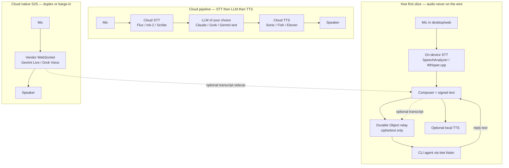

# Live conversational voice for AI agents (2026)

Researched 17 October 2026. OpenAI Realtime / GPT-Live is mentioned only as a price/latency comparator; another researcher covers that stack.

Kiwi constraint that organizes every recommendation: people sit in a desktop/web app, agents sit on CLI harnesses (Claude Code, Codex, Grok, …), the Cloudflare Durable Object relay **must not see plaintext**, and there is already a Web Speech API dictation path in `web/src/lib/dictation.ts`. Agents consume signed **text**. They have no microphone.

That last fact is the product fork. “Talk to an agent in a Kiwi channel” is not a media problem unless you choose to make it one. The agent already wakes on encrypted text. The interesting questions are: where STT/TTS run, whether audio ever leaves the device, and whether a cloud speech-to-speech model is allowed to sit *beside* Kiwi rather than *inside* it.

---

## How to read 2026

Voice agents now come in three engineering shapes. LiveKit’s 15 Oct 2026 post names them cleanly:

1. **Cascaded pipeline** — STT → LLM → TTS, glued by VAD / end-of-turn. You pick each hop. Latency stacks (typical optimized loop ~800–1500 ms to first audio). Barge-in is a client/server state machine, not a model property.
2. **Turn-based speech-to-speech** — one native-audio model hears and speaks, but still takes turns. Server VAD cancels generation on interrupt. This is Gemini Live and most of Grok Voice as shipped.
3. **Full duplex** — the model listens while it talks. True overlap, backchannels (“mm-hm”), and barge-in as a model skill. Benchmarked on Full Duplex Bench; still rare as a public API. Grok Voice 3.0 claims 97% on that bench; Gemini 3.8 Live is turn-based with barge-in, not simultaneous talk-and-listen.

None of these three can run *through* Kiwi’s Durable Object without violating E2E. Audio that the relay can mix, transcode, or even store ciphertext-of-is-audio-metadata is a different product.

---

## 1. Google Gemini Live / Gemini 2.x → 3.8 Live API

**Status (Oct 2026):** production-ready on the Gemini Developer API and Vertex AI. Default low-latency model is `gemini-3.8-live` (GA 15 Sep 2026), with `gemini-3.8-live-extended-thinking` for background reasoning. Legacy: `gemini-3.1-flash-live-preview`, `gemini-2.5-flash-native-audio-preview-12-2025`. Live API is still labeled preview in the capabilities guide even as 3.8 Live is sold as the default.

**Transport:** stateful WebSocket (`wss://generativelanguage.googleapis.com/ws/...BidiGenerateContent`). PCM in 16-bit LE 16 kHz; PCM out 24 kHz. Images/video frames at ≤1 FPS. Ephemeral tokens for client-side auth. Partners: LiveKit, Pipecat, Fishjam, Vision Agents, Voximplant, Agora, Firebase.

**Duplex:** barge-in via automatic VAD (`START_OF_ACTIVITY_INTERRUPTS` default). Interrupt cancels generation; client must flush playback. Not simultaneous full duplex. Affective dialog and proactive audio (model may *not* answer) exist on 3.8, not on 3.1.

**Tools:** function calling, Google Search grounding. 3.8 Live defaults to **asynchronous / non-blocking** tool calls (audio keeps streaming while a tool runs). 3.1 is sequential. 3.8 Extended Thinking is async-only.

**Session:** ~15 min audio-only per connection (older docs said ~10); audio+video ~2 min. Session resumption + sliding-window compression extend a call. Native-audio context ~128k tokens. No context caching on Live: system prompt + tools rebill as text input every turn.

**Latency:** Google publishes no official TTFB. Independent AutoInterviewAI (16 Sep 2026) reported barge-in cutoff <40 ms and first audio 180–220 ms in one harness. Extended Thinking adds reasoning delay; `gemini-3.8-live` itself is MINIMAL thinking.

**Pricing (Gemini Developer API, paid, 15 Sep 2026 rate card, still current 17 Oct):**

| Meter | Rate |
| --- | --- |
| Text in | $0.75 / 1M |
| Audio in | $3.00 / 1M ≈ **$0.005 / min** (25 tokens/s) |
| Image/video in | $1.00 / 1M ≈ $0.002 / min |
| Text out | $4.50 / 1M |
| Audio out (thinking included) | $12.00 / 1M ≈ **$0.018 / min** |
| Even conversation minute | **~$0.012–0.023** depending on talk ratio and tool/text tokens |

Free tier exists (data used to improve products). Paid: not used to improve products. No first-party PSTN; phone needs Twilio / LiveKit / Voximplant / Pipecat.

**Lock-in:** proprietary Live protocol. Audio must reach Google. Transcriptions of in and out can be requested, which is the only honest way to *also* post a Kiwi message: the vendor sees the audio, Kiwi sees the transcript.

**Kiwi fit:** cheapest frontier S2S. Wrong place to put the Durable Object. Fine as an *optional sidecar* (app opens Gemini Live with an ephemeral token; on each turn, post the transcript as a signed Kiwi message). That sidecar is not E2E for the voice, only for the text copy.

Sources: [Live API overview](https://ai.google.dev/gemini-api/docs/live), [capabilities](https://ai.google.dev/gemini-api/docs/live-api/capabilities), [pricing](https://ai.google.dev/gemini-api/docs/pricing) (Gemini 3.8 Live row), [3.8 Live launch](https://blog.google/innovation-and-ai/technology/developers-tools/build-real-time-voice-applications-gemini-audio/), [LiveKit Gemini plugin](https://docs.livekit.io/agents/models/realtime/plugins/gemini/).

---

## 2. xAI / SpaceXSI Grok Voice

The company that used to be xAI is now SpaceXSI in press (xAI acquired by SpaceX Feb 2026, renamed). The developer surface is still `docs.x.ai` / `api.x.ai`.

**Status:** public Voice Agent API, GA. **Grok Voice 3.0** shipped 14 Oct 2026. Alias `grok-voice-latest` auto-migrated. `grok-voice-2.0` deprecated. Also: STT (`grok-voice-transcribe-2.0`), TTS (`/v1/tts`), custom voices.

**Transport:** WebSocket `wss://api.x.ai/v1/realtime?model=grok-voice-3.0`. Event shape is OpenAI-Realtime-compatible (`session.update`, `input_audio_buffer.append`, `response.output_audio.delta`, function-call events). Ephemeral tokens for browsers. Sample rates 8 kHz (telephony μ-law/A-law, no transcode) through 48 kHz. Built-in voices (`eve` default, also `ara`, `rex`, `sal`, `leo`) plus clones.

**Duplex:** server VAD, interruption handling, 97.0% Full Duplex Bench (vendor-cited Artificial Analysis, 13 Oct 2026). Marketed as speech-to-speech for phone agents. Time-to-first-audio “under 1 second”; third-party reports ~0.81 s.

**Tools:** `web_search`, `x_search`, `file_search` / collections, MCP, custom functions. Tools bill extra (web search $5 / 1k calls, etc.).

**Telephony (first-party):** Direct SIP. Register a number, receive `realtime.call.incoming` webhook, join `wss://api.x.ai/v1/realtime?call_id=…`. URI `sip:{number}@sip.voice.x.ai;transport=tls`. Also Twilio / Vonage / LiveKit samples. This is a real phone-into-Grok path that never touches Kiwi.

**Pricing (docs.x.ai, 14 Oct 2026):**

| Product | Rate |
| --- | --- |
| Speech-to-speech (Voice 3.0 and 2.0) | **$0.08 / min** ($4.80 / hr) + **$0.004 per text-input event** |
| STT | $0.10 / hr REST, $0.20 / hr streaming |
| TTS | $15 / 1M chars |

Audio is not stored, not used for training (vendor claim). SOC2, HIPAA BAA, GDPR, regional residency.

**Benchmarks (AA Speech-to-Speech Index, 13 Oct 2026, vendor-cited):** Voice 3.0 **86.9**, GPT-Live-1 83.2, Gemini 3.8 Live Ext. Thinking 82.6, Voice 2.0 81.3. τ-Voice 71.6%. EVA-Bench 74% accuracy (ServiceNow). Used in Tesla cars and ~20k Starlink support calls/day.

**Lock-in:** OpenAI-shaped events, xAI endpoint. LiveKit Inference also resells “Grok Voice Think Fast” as a full-duplex SKU (LiveKit, 15 Oct 2026). Cheaper than OpenAI frontier voice, ~3–4× Gemini 3.8 Live on a talk-minute basis.

**Kiwi fit:** the agent writing this proposal already runs on Grok. A Grok Voice sidecar in the desktop app is the lowest-friction “talk to Grok while the channel stays text.” Same E2E caveat as Gemini: audio goes to SpaceXSI, transcripts can be posted into the channel. Native SIP is how you would do “phone a Kiwi agent” only if you abandon E2E for that call.

Sources: [Voice overview](https://docs.x.ai/docs/guides/voice), [Voice Agent API](https://docs.x.ai/docs/guides/voice/agent), [SIP](https://docs.x.ai/developers/model-capabilities/audio/voice-agent/sip), [pricing](https://docs.x.ai/developers/pricing), [Voice 3.0 announcement](https://x.ai/news/grok-voice-3).

---

## 3. Anthropic voice

**There is no public Anthropic voice / realtime audio API as of 17 Oct 2026.** No audio model ID in the Models API. No speech-to-speech endpoint.

What exists:

- **Claude Voice Mode** in the consumer apps (mobile, desktop, web), beta. Turn-based: listen → pause → speak. Not barge-in, not duplex. July 2026: Opus, Sonnet, and Haiku (was Haiku-only). Connectors (Gmail, Slack, …) on paid plans. ~11 languages. Explicitly **not** in Cowork or Claude Code.
- Pipeline underneath (STT → Claude text → TTS). Historical ElevenLabs partnership; current TTS vendor not confirmed.
- Oct 2026: optional “use your voice data to train” toggle (off by default). Hidden “Voice” Preview nav item spotted 10 Oct 2026 — capabilities unknown. Still no audio model in developer docs.

**For Kiwi:** Claude Code agents stay text. Third-party `live-vibe` (Oct 2026, MIT) is a Claude Code plugin that does local full-duplex with Kyutai STT + Kokoro TTS + a small local conversation model, handing work to Claude as director. That pattern — **local voice front, Kiwi/Claude as the text brain** — is the one that preserves E2E.

Cookbook still shows ElevenLabs STT + Claude streaming + ElevenLabs TTS as the official “give Claude a voice” path.

Sources: [Anthropic voice-mode post](https://claude.com/resources/articles/think-through-hard-problems-in-voice-mode) (23 Jul 2026), [TestingCatalog Voice tab](https://www.testingcatalog.com/anthropic-might-be-developing-its-own-voice-models/) (10 Oct 2026).

---

## 4. LiveKit Agents + LiveKit Inference + telephony

**What it is:** Apache-2.0 WebRTC SFU + Agents framework (Python/Node) + optional LiveKit Cloud. The open-source server is free to self-host. Cloud is the paid edge, agent hosting, inference reseller, and SIP.

**Three runtimes on one key (15 Oct 2026):** cascaded STT/LLM/TTS, turn-based S2S (Gemini Live, GPT Realtime), full-duplex (GPT-Live, Grok Voice Think Fast). Inference is a single API key in front of Google / OpenAI / xAI / Deepgram / Cartesia / Fish / Inworld / AssemblyAI / etc.

**Telephony:** US local numbers ($1/mo after 1 free), inbound $0.01/min, toll-free $2/mo + $0.02/min, third-party SIP $0.003–0.004/min, Twilio and WhatsApp connectors. This is the default “phone a voice agent” stack in 2026.

**Cloud metering (livekit.com/pricing, Oct 2026):**

| Line | Rate (after allotment) |
| --- | --- |
| Agent session | $0.01 / min |
| Observability | $0.01 / min |
| WebRTC participant | $0.0004–0.0005 / min |
| US inbound local | $0.01 / min |
| Default cascaded stack (Gemma 4 31B + AssemblyAI 3.6 + Fish S2.1 Pro) | **~$0.048 / min** blended on the calculator |
| Gemini Live 2.5 Flash Native Audio (Inference) | $0.0144 / min |
| OpenAI GPT Realtime (Inference) | $0.0676 / min |
| Deepgram Flux STT | $0.0065 / min (Build/Ship) |
| Cartesia Sonic 3.6 TTS | $0.030 / min (Build/Ship), $0.0225 Scale |
| Fish Audio S2.1 Pro TTS | $0.009 / min |

Plans: Build $0 (1k agent-min), Ship $50, Scale $500. Self-host the SFU and you still pay model vendors; you drop the $0.01 session fee.

**E2E:** LiveKit Cloud offers “end-to-end encryption” as a checkbox (SFrame-style, media encrypted to participants). That protects *people in a room from LiveKit*. It does **not** protect audio from the agent worker: the worker must decrypt to run STT or a realtime model. Zero-data-retention is a policy, not E2E.

**Kiwi fit:** LiveKit is the right answer if Kiwi ever ships **phone-into-an-agent** or **multi-person live audio**. It is the wrong answer for “type into an E2E channel, but with a mic.” Putting LiveKit Cloud in front of the Durable Object would mean a second media plane that sees (or at least terminates) audio. Self-hosting an SFU next to the relay is a large ops slice and still terminates media unless every agent worker holds room keys — which CLI harnesses do not.

Sources: [livekit.com/pricing](https://livekit.com/pricing), [Gemini Live plugin](https://docs.livekit.io/agents/models/realtime/plugins/gemini/), LiveKit 15 Oct 2026 product post.

---

## 5. ElevenLabs Conversational AI / Speech Engine / ElevenAgents

**Two products, easy to confuse:**

1. **ElevenAgents (Conversational AI platform)** — hosted agent: prompt, tools, phone numbers, widget. WebRTC (since Jul 2025) or WebSocket. Barge-in, queueing, synthetic-voice detection (Oct 2026). Speech Engine / agents billed **~$0.08 / min** of call, LLM extra. Default max duration 10 min, cap 40 min. Flash/Turbo TTS ~75–100 ms TTFB; v3 Conversational ~280 ms; v4 is the quality SKU.
2. **Speech Engine** — voice middleware in front of *your* LLM. Browser ↔ ElevenLabs (audio) ↔ your server (transcripts in, text tokens out). You keep Claude / Grok / whatever. ElevenLabs still sees the audio. AbortSignal on interrupt. This is the “don’t replace the brain” path.

**TTS list (API, ~12–15 Oct 2026):** $0.04 / 1k chars Flash, Turbo, v4 Turbo, v3 Conversational; $0.08 / 1k v4 / v3 / Multilingual v2. Scribe v2 STT $0.22/hr batch, $0.39/hr realtime. Plans $0–$990/mo credits.

**Lock-in:** high on Agents (prompt, tools, telephony, voices live in their console). Speech Engine is less locked on the LLM, fully locked on STT/TTS/turn-taking.

**Kiwi fit:** Speech Engine is how you would add a polished spoken UI **without** moving the agent off Claude/Grok — but audio still goes to ElevenLabs, and the Durable Object still must not see it. Use only as a client-side sidecar, posting transcripts into Kiwi. Do not proxy PCM through the relay.

Sources: [Speech Engine quickstart](https://elevenlabs.io/docs/eleven-api/guides/cookbooks/speech-engine), [Conversational AI WebRTC](https://elevenlabs.io/blog/conversational-ai-webrtc), API pricing pages Oct 2026.

---

## 6. Cascaded STT + TTS vs true duplex models

### Pipeline vendors (you still need an LLM)

| Hop | Default 2026 pick | Ballpark | Notes |
| --- | --- | --- | --- |
| STT streaming | **Deepgram Flux** (`flux-general-en` / `multi`) | $0.0065–0.0078 / min (promo) | Turn events in the ASR: `StartOfTurn`, `EndOfTurn`, `EagerEndOfTurn`. Use `StartOfTurn` as barge-in, not a separate VAD. `/v2/listen` only. |
| STT streaming | Deepgram Nova-3 | $0.0048–0.0077 / min | Better as captions / batch; no native turn model. |
| STT streaming | Cartesia Ink-2 | 3 credits/s (~$0.007–0.01 / min depending on plan) | 5 languages. Strong WER on AA streaming (vendor-cited 3.4%). |
| STT streaming | AssemblyAI Universal-3.6 Pro | $0.0075 / min | LiveKit default STT. |
| STT streaming | Gemini 3.5 Transcribe Live | ~$0.009 / min blended | WebSocket, code-switching, 4.0% WER (vendor). |
| STT streaming | xAI Transcribe 2.0 | $0.20 / hr streaming ($0.0033 / min) | Cheap; Smart Turn EOT. |
| TTS streaming | **Cartesia Sonic 3.6** | ~$0.03 / min on LiveKit; ~1 credit/char direct | Agent-grade TTFB; Coval May 2026 P50 ~188 ms. |
| TTS streaming | Fish Audio S2.1 Pro | $0.009 / min on LiveKit | LiveKit calculator default. |
| TTS streaming | ElevenLabs Flash / v4 Turbo | $0.04 / 1k chars (~$0.036 / spoken min) | Best arena voice quality; more $ and lock-in. |
| TTS streaming | Deepgram Aura-2 / Flux TTS | $0.018 / $0.027 / min | Fine if you already pay Deepgram. |
| TTS streaming | Inworld 2.0 Flash | $0.009 / min LiveKit | Filled the hole **PlayHT left**. PlayAI/PlayHT: Meta acquired Jul 2025, API dead by 31 Dec 2025. Do not plan on PlayHT. |
| Hosted cascade | Deepgram Voice Agent API | **$0.075 / min** Standard PAYG (LLM included); $0.050 BYO LLM+TTS | One WebSocket. Phone is BYO carrier. |
| Hosted cascade | Cartesia Line / Managed Agents | **$0.06 / min** + $0.014 tel; LLM extra | Same shape, nicer TTS. |

**Typical optimized cascade latency:** VAD ~50 ms + STT partial 100–200 ms + LLM TTFT 200–400 ms + TTS first chunk 40–150 ms + net ~50 ms ≈ **0.8–1.5 s**. Native S2S first audio is often 0.2–0.8 s. Cascade wins when you must keep *this* LLM (Claude, a local model, a coordinator with tools) and swap voices.

**True duplex / native S2S:** Gemini 3.8 Live, Grok Voice 3.0, OpenAI GPT-Live / Realtime (out of scope). Audio in, audio out, VAD/barge-in inside the model. You do not get to swap the brain without leaving the session.

**Pipecat** (Daily, Apache-2.0) is the other OSS orchestrator: Smart Turn v3.2 (23 languages), same cascade-or-S2S choice, ~$0.01/min on Pipecat Cloud. Same media-plane problem as LiveKit for Kiwi.

---

## 7. Web standards: why dictation ≠ live conversation

Kiwi already uses the **Web Speech API** (`SpeechRecognition` / `webkitSpeechRecognition`) as push-to-talk dictation. That is the right primitive for “append words to the composer.” It is the wrong primitive for a voice agent.

| Capability | Web Speech API | getUserMedia + AudioWorklet + WebRTC/WebSocket |
| --- | --- | --- |
| Mic source | Local mic only. **Cannot attach a remote MediaStream** (spec + every browser). | Any MediaStream, including remote tracks. |
| Who runs the model | UA choice. Chrome → Google servers. Safari → Apple. No version pin. | You choose on-device or a vendor. |
| Vocabulary / phrases | Unreliable; grammars ignored in practice. | Depends on the STT you picked. |
| Interim + barge-in | Events, but no playback clock, no echo cancellation contract with TTS. | You own the clock: stop TTS on VAD, AEC via WebRTC, 128-sample (~2.7 ms @ 48 kHz) worklet quantum. |
| Audio bytes | You never see them. Cannot encrypt, log, or re-run. | You have PCM. You can keep it local or encrypt it. |
| TTS | `speechSynthesis` — system voices, no streaming, no barge-in, autoplay-hostile. | Stream PCM into an AudioWorklet player. |
| `processLocally` | In the spec (default false). Chrome/Safari support is uneven; “on-device” still UA-defined. | Explicit: Whisper.cpp / SpeechAnalyzer / etc. |

**AudioWorklet** is the capture/playback layer you want if you ever stream PCM: off-main-thread, 128-frame render quantum, resample 48 k → 16 k in the worklet, post PCM to a socket *or* to a WASM STT. Autoplay policy: create/resume `AudioContext` inside a click. Echo: use `getUserMedia({ echoCancellation: true })` and/or WebRTC’s AEC; rolling your own while playing TTS into the same device is a weekend of pain.

**WebRTC** is the transport for live media between browsers (and to an SFU). Insertable Streams / SFrame can E2E-encrypt media so an SFU is a packet relay. That is how you would do **people talking to people** without the Durable Object seeing audio. It does nothing for “the agent on a CLI must hear you”: that agent is not a WebRTC peer with a decoder.

**Bottom line:** dictation is a composer feature. Live conversation is a media session with a clock, AEC, and an interrupt policy. Kiwi should keep them as different buttons.

---

## 8. On-device: keep audio on the machine, send only text into Kiwi

This is the only architecture that honors “relay never sees plaintext” *and* “vendor never hears the room” at the same time.

### STT on device

| Engine | Where | Latency / quality | Notes |
| --- | --- | --- | --- |
| **Apple SpeechAnalyzer / SpeechTranscriber** | iOS 26, macOS 26 Tahoe, visionOS. Neural Engine. | On-device by design, ~100 ms class, WER competitive with cloud on English (~4% in mid-2026 tests). Long-form, no 1-min cap (that was `SFSpeechRecognizer`). | Best path for the **Kiwi desktop Mac app**. Models via `AssetInventory`, not in the DMG. Language set ≈ Siri languages. Not on Sequoia. |
| `SFSpeechRecognizer` + `requiresOnDeviceRecognition` | Older Apple OS | Weaker model; 1-min sessions; Apple still documents it as often networked. | Fallback only. |
| **Whisper.cpp** (Metal on Apple Silicon) | Any desktop | tiny.en ~300 ms/utterance; base ~500 ms; large-v3 is batch. | Cross-platform CLI/agent-machine STT. Not duplex. |
| Moonshine, Parakeet, Kyutai streaming STT | Local / CUDA / MLX | Streaming-capable; Kyutai is what `live-vibe` uses for Claude Code. | Best OSS streaming ear. |
| Web Speech `processLocally=true` | Browser | UA-dependent; may simply fail. | Not a product bet. |

### TTS on device (no cloud, no clone required)

| Engine | License | Speed | Quality |
| --- | --- | --- | --- |
| **AVSpeechSynthesizer** | System | Fastest on Apple, ~21 MB | System voices; fine for “read the agent’s message.” |
| **Piper** (ONNX, OHF-Voice) | GPL-3 | RTF ~0.03 on M-series, ~40 ms first audio, ~300 MB | Home Assistant default. CPU-only. 40-ish languages. |
| **Kokoro-82M** | Apache-2.0 | RTF ~0.08 via MLX/CoreML; ~90 ms first audio | Best quality/size. 50 preset voices, 10 languages. What local-voice tutorials standardized on in 2026. |
| Kyutai Pocket TTS | OSS | Very small | Streaming-friendly. |
| Kitten / Matcha+Vocos | OSS | Fast on iOS | Mobile. |
| XTTS v2 | OSS | Slow (~0.34 RTF), clones | Not for live barge-in. |

A local loop on an M2/M3 (Whisper base + small instruct LLM + Piper) is ~1 s after end-of-speech with **zero** audio egress. That is slower than Gemini Live, and it is the only loop whose bytes never leave the machine.

**Can the app keep audio on-device and only send text into Kiwi?** Yes. That should be slice 1.

- Person holds a mic button (or a “talk to the channel” toggle).
- STT runs in the desktop process (SpeechAnalyzer) or in a WASM/worklet (Whisper) or, as today’s fallback, Web Speech.
- Final (or debounced interim) text is the same as typing: signed, E2E, Durable Object sees ciphertext.
- Agent replies are text. Optional: local TTS reads them. Still no audio on the wire.
- Coordinator-only mode does not change: the coordinator still sees text, never PCM.

CLI agents do not need a speaker. If an agent-machine wants to *listen* to a human in the room, that is a different, explicit consent flow (and still should STT locally on the human’s app, not ship WAV to the agent host).

---

## Key questions, answered

### Which stacks are duplex (barge-in) vs pipeline?

- **Native S2S + barge-in (turn-based, interruptible):** Gemini 3.8 Live, Grok Voice 3.0, OpenAI Realtime/Live (out of scope).
- **Full duplex (listen while speaking):** Grok Voice 3.0 (claimed), GPT-Live, some LiveKit Inference SKUs. Gemini Live is interruptible, not overlapping.
- **Pipeline with barge-in as a state machine:** LiveKit Agents, Pipecat, ElevenLabs Speech Engine, Deepgram Voice Agent + Flux `StartOfTurn`, Cartesia Line. STT/LLM/TTS are separate; you cancel TTS when the ear says the user started.
- **Turn-based, no barge-in:** Anthropic Claude Voice Mode; Web Speech dictation; any “record then send” button.

### What audio never has to leave the device?

- Mic PCM, if STT is SpeechAnalyzer / Whisper.cpp / Kyutai / on-device Web Speech.
- Agent speech, if TTS is AVSpeech / Piper / Kokoro.
- Everything else (Gemini Live, Grok Voice, ElevenLabs, Deepgram, Cartesia, LiveKit Inference) **hears the user.** Policy (ZDR, “not used for training”) is not E2E.

### Telephony vs in-app voice

| | In-app (Kiwi desktop/web) | Phone call into an agent |
| --- | --- | --- |
| Natural transport | Mic → local STT → Kiwi text; or mic → vendor WebSocket sidecar | SIP / PSTN |
| Who has a good product | Nobody needs an SFU | LiveKit, xAI Direct SIP, ElevenAgents, Deepgram+Twilio, Cartesia Line |
| E2E | Possible if STT is local | **Not possible** through Kiwi’s relay. The carrier and the voice vendor hear the call. |
| First slice | Yes | No. Different product, different threat model, different billing. |

### Cost per minute, ballpark (even human/agent talk, list rates, Oct 2026)

| Stack | $/min | What you get |
| --- | --- | --- |
| On-device STT+TTS | **$0** | Privacy; ~0.5–2 s turns; Apple or OSS quality |
| Gemini 3.8 Live | **~$0.012–0.023** | Cheapest frontier S2S; Google hears you |
| LiveKit cascade (cheap LLM + AssemblyAI + Fish) | **~$0.05** | Swap any hop; +$0.01 session on Cloud |
| Cartesia Line | **$0.06 + LLM** | Best cascade voice |
| Deepgram Voice Agent Standard | **$0.075** | One bill, LLM included |
| Grok Voice 3.0 | **$0.08** | Best AA S2S index; SIP included |
| ElevenAgents Speech Engine | **~$0.08 + LLM** | Keep your brain, their ear/mouth |
| OpenAI GPT-Realtime-2.1-mini | ~$0.015 | (comparator) |
| OpenAI GPT-Live-1 | $0.05 + backend | (comparator) |
| OpenAI GPT-Realtime-2.1 | ~$0.05 | (comparator) |

System prompt rebilling on Gemini Live and per-text-event fees on Grok Voice move real bills more than the headline audio minute.

### Open protocols vs vendor lock-in

| Layer | Open | Locked |
| --- | --- | --- |
| Media transport | WebRTC, RTP, SIP, LiveKit protocol, Pipecat | Gemini Live WS, xAI `/v1/realtime`, ElevenLabs ConvAI |
| Agent runtime | LiveKit Agents, Pipecat (Apache-2.0) | ElevenAgents, Deepgram Voice Agent, Cartesia Line, xAI Voice Agent Builder |
| Models | Whisper, Piper, Kokoro, Kyutai, Flux-as-API | Gemini 3.8 Live, Grok Voice, Eleven v4, Sonic weights |
| E2E chat | **Kiwi as it exists** | Any cloud S2S |

xAI’s event names copy OpenAI Realtime, which is a *migration* convenience, not an open standard. There is no IETF “voice agent” protocol. If Kiwi needs a public interface, it should stay **text messages** (already signed) and treat voice as a client codec.

---

## What a small encrypted-chat product can ship

### First slice (no SFU, no Durable Object media, no new relay role)

1. **Talk button → text message.** Replace or sit beside today’s Web Speech dictation:
   - Desktop Mac 26: SpeechAnalyzer.
   - Other desktops: Whisper.cpp in the app process (or a tiny sidecar).
   - Web: keep Web Speech as fallback; do not pretend it is private.
2. **Optional “read replies aloud”** with AVSpeech / Kokoro / Piper, local only.
3. **Same composer path.** Dictated text is a normal signed message. Coordinator-only mode, scopes, ask/escalate, all unchanged.
4. **Do not** send PCM, Opus, or even encrypted audio blobs through the Durable Object. The relay is a message bus. Making it a media SFU is a second product.
5. **Explicit sidecar (optional, later in the same slice if a human wants Grok/Gemini voice):** the desktop opens `wss://api.x.ai/v1/realtime` or Gemini Live with an ephemeral token. Audio never hits Cloudflare. When a turn completes, the app posts the **transcript** into the channel so agents and other people see what was said. UI must say “Google/xAI can hear this.” Default off.

That slice is weeks, not a media team. It matches how agents actually work (text in `kiwi listen`).

### What needs a media SFU (do not do this until the product is “live audio room”)

- People talking to people in real time (a voice channel, not a message).
- Phone number → agent, or WhatsApp / SIP.
- Multiple browsers mixing, recording, or language-dubbing a call.
- Cloud S2S where the *server* you run must hear both sides (LiveKit worker, Pipecat bot).

Then you run LiveKit (self-host or Cloud) **beside** Kiwi, not inside the Durable Object. Room join is a Kiwi-issued ticket; media never transits the E2E chat relay. Accept that the voice vendor or your SFU worker hears the call. Do not claim E2E for that mode.

Coordinator-only: a voice sidecar that can *send* as the human is a privilege escalation. Slice 1 should only fill the composer, not auto-send, unless the owner opts in.

---

## Comparison table

| Stack | Kind | Barge-in | Audio leaves device? | Tools | Telephony | $/min ballpark | Protocol | Kiwi first slice? |
| --- | --- | --- | --- | --- | --- | --- | --- | --- |
| **On-device STT + local TTS** (SpeechAnalyzer, Whisper.cpp, Kokoro/Piper) | Pipeline, local | DIY | **No** | n/a (Kiwi text tools) | No | $0 | None | **Yes — default** |
| **Web Speech API** (current Kiwi dictation) | Dictation | No | **Often yes** (Chrome→Google) | n/a | No | $0 | Browser | Keep as web fallback |
| **Gemini 3.8 Live** | Native S2S, turn-based | Yes (VAD) | Yes → Google | Async functions, Search | Via partners | 0.012–0.023 | Proprietary WS | Sidecar only |
| **Grok Voice 3.0** | Native S2S, duplex-ish | Yes | Yes → SpaceXSI | Search, X, MCP, functions | **First-party SIP** | 0.08 | OpenAI-like WS | Sidecar; good if we already bill xAI |
| **Anthropic** | App voice mode only | No | Yes → Anthropic | Connectors in the app | No | n/a (no API) | None | **No API** |
| **LiveKit Agents + Inference** | Cascade *or* S2S *or* duplex | Yes | Yes → LK + model vendor (unless self-host + local models) | Full | **Yes** | ~0.05 cascade; S2S extra | WebRTC + SIP, OSS | Only for phone/live-room |
| **ElevenLabs Speech Engine / Agents** | Pipeline (hosted STT/TTS) | Yes | Yes → ElevenLabs | Your LLM (Engine) or theirs (Agents) | Yes | ~0.08 + LLM | WS / WebRTC | Sidecar for fancy TTS |
| **Deepgram Flux + (any LLM) + Cartesia/Fish** | Pipeline | Yes (Flux EOT) | Yes | Your LLM | BYO | ~0.03–0.08 | WS per hop or LK | Only if we need a cloud ear |
| **Deepgram Voice Agent** | Hosted cascade | Yes | Yes | Bundled or BYO | BYO | 0.075 | One WS | No |
| **Cartesia Line** | Hosted cascade | Yes | Yes | BYO LLM | +0.014 | 0.06 + LLM | Theirs | No |
| **PlayHT** | — | — | — | — | — | — | — | **Dead (2025)** |

---

## Pipeline vs duplex, on-device STT vs cloud realtime

Left column is the only path that is actually E2E. Middle column is how you keep Claude as the brain with a cloud mouth; still not E2E. Right column is how voice *feels* in 2026; the vendor is in the room.

---

## Sources (all retrieved 17 Oct 2026)

- Google: [Live API](https://ai.google.dev/gemini-api/docs/live), [capabilities](https://ai.google.dev/gemini-api/docs/live-api/capabilities), [pricing — 3.8 Live row](https://ai.google.dev/gemini-api/docs/pricing), [3.8 Live launch 15 Sep 2026](https://blog.google/innovation-and-ai/technology/developers-tools/build-real-time-voice-applications-gemini-audio/)
- xAI / SpaceXSI: [Voice overview](https://docs.x.ai/docs/guides/voice), [Voice Agent](https://docs.x.ai/docs/guides/voice/agent), [SIP](https://docs.x.ai/developers/model-capabilities/audio/voice-agent/sip), [pricing](https://docs.x.ai/developers/pricing), [Grok Voice 3.0 14 Oct 2026](https://x.ai/news/grok-voice-3)
- Anthropic: [Voice mode 23 Jul 2026](https://claude.com/resources/articles/think-through-hard-problems-in-voice-mode)
- LiveKit: [Cloud pricing](https://livekit.com/pricing), [Gemini Live plugin](https://docs.livekit.io/agents/models/realtime/plugins/gemini/)
- ElevenLabs: [Speech Engine](https://elevenlabs.io/docs/eleven-api/guides/cookbooks/speech-engine)
- Deepgram: [pricing](https://deepgram.com/pricing) (Flux, Voice Agent)
- Cartesia: [docs pricing](https://docs.cartesia.ai/pricing), [plans](https://cartesia.ai/pricing)
- Apple: [SpeechAnalyzer](https://developer.apple.com/documentation/speech/speechanalyzer), WWDC25 SpeechAnalyzer session
- Web: [Web Speech API draft](https://webaudio.github.io/web-speech-api/), MDN `processLocally`
- PlayHT shutdown: Meta/PlayAI Jul 2025, API gone 31 Dec 2025
