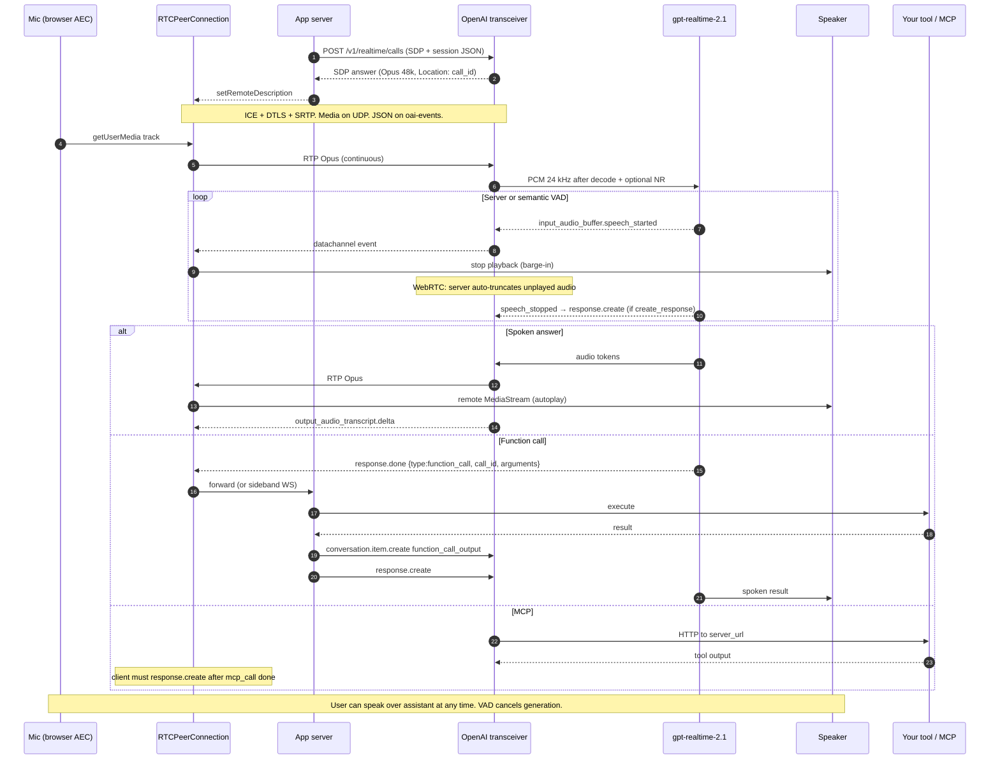
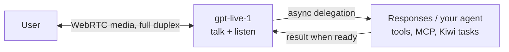

# How OpenAI nailed live conversation (as of 17 Oct 2026)

Dense product-design note for a Kiwi Channels bounce. Kiwi is E2E-encrypted multi-agent chat (people + CLI agents, coordinator mode, tasks). Audio today is only browser `SpeechRecognition` dictation into the composer. The question is what OpenAI actually built so a Kiwi equivalent can copy the *feel* without copying the architecture that ships raw audio to a third-party cloud.

Two OpenAI products now exist. They are **not** the same API:

| Surface | Endpoint | Role | Duplex |
|---|---|---|---|
| **Realtime API** | `v1/realtime` | One speech-to-speech model does listen, reason, talk, and tools | Turn-based with barge-in. Server VAD / semantic VAD decides when the user is done. |
| **GPT-Live** | `v1/live/sessions` | Full-duplex voice frontend + delegated backend (Responses or client agent) | Listens while speaking. No turn detector on the audio path. |

ChatGPT Advanced Voice Mode (2024) became ChatGPT Voice on GPT-Live (2026). The Realtime API is the developer speech-to-speech product; GPT-Live is the newer full-duplex product that ChatGPT Voice actually runs on. A Kiwi design should steal ideas from both, and should not assume they are interchangeable.

---

## 1. Current Realtime API shape

Sources: [Realtime getting started](https://developers.openai.com/api/docs/guides/realtime/), [conversations](https://developers.openai.com/api/docs/guides/realtime-conversations/), [WebRTC](https://developers.openai.com/api/docs/guides/voice-webrtc?api=realtime), [tools/MCP](https://developers.openai.com/api/docs/guides/realtime-mcp), [client events](https://developers.openai.com/api/reference/resources/realtime/client-events/).

### Transports

Three transports. Pick by where the microphone lives.

| Transport | Best for | Audio path | Control path |
|---|---|---|---|
| **WebRTC** | Browser / mobile | Negotiated media tracks. Browser AEC, jitter buffer, Opus. | Data channel labeled `oai-events` (JSON). |
| **WebSocket** | Trusted server ↔ OpenAI | Base64 PCM (or G.711) in JSON events on the same socket. | Same socket, same ordering. |
| **SIP** | Phone / PBX | Telephony media. | Sideband WebSocket on `call_id`. |

Official recommendation: **WebRTC for anything with a mic in a client**; WebSocket only for a middle-tier that already owns a media pipeline (Twilio, LiveKit, a PBX bridge). WebSockets are not recommended for browser audio because they lose congestion control, AEC, and packet-loss concealment. OpenAI’s own SDP answer advertises `opus/48000/2` plus G.711 PCMU/PCMA fallback ([webrtcHacks teardown](https://webrtchacks.com/the-unofficial-guide-to-openai-realtime-webrtc-api/)).

Auth for browsers: never put a project key in the client.

1. **Unified interface (preferred):** browser POSTs SDP to *your* server; your server POSTs multipart `{sdp, session}` to `POST /v1/realtime/calls` with the project key; you return the SDP answer. Server is on the critical path for setup.
2. **Ephemeral client secret:** your server `POST /v1/realtime/client_secrets` → `ek_…` token (configurable TTL, typically minutes; session itself can outlive the secret). Browser POSTs SDP to `/v1/realtime/calls` with `Authorization: Bearer ek_…`.

GA vs beta: drop `OpenAI-Beta: realtime=v1`. Use `/v1/realtime/client_secrets` and `/v1/realtime/calls`. Session config is nested (`session.type`, `session.audio.input` / `session.audio.output`). Event names are `response.output_audio.delta`, `response.output_audio_transcript.delta`, `response.output_text.delta`.

### Models (Realtime, Oct 2026)

Current default for new work: **`gpt-realtime-2.1`**. Mini: `gpt-realtime-2.1-mini`.

Lineage:

| When | Model | Notes |
|---|---|---|
| Oct 2024 | `gpt-4o-realtime-preview` | Public beta. Speech-to-speech proof. |
| Dec 2024 | `gpt-4o-realtime-preview-2024-12-17` | Better quality. |
| 3 Jun 2025 | `gpt-4o-realtime-preview-2025-06-03` | Last 4o snapshot; EU residency. |
| **28 Aug 2025** | **`gpt-realtime` GA** | First GA S2S. MCP, image input, SIP, async function calling. Voices Marin/Cedar. 20% cheaper than 4o-realtime. 32k context. |
| Oct 2025 | `gpt-realtime-mini` | Cheap/fast tier. |
| ~Feb 2026 | `gpt-realtime-1.5` | Mid-gen. Still 32k. |
| **7 May 2026** | **`gpt-realtime-2`** | GPT-5-class reasoning. 128k context. Reasoning effort `minimal|low|medium|high|xhigh` (default `low`). Preambles, parallel tools. Translate + Whisper siblings. |
| **6 Jul 2026** | **`gpt-realtime-2.1` / `-mini`** | Better alphanumerics, silence/noise, interruption. p95 latency −25% via caching. **Use this.** |

Also on the Realtime surface, not S2S conversation:

- **`gpt-realtime-whisper`** / `gpt-live-transcribe` / `gpt-4o-transcribe*` — streaming STT. Session `type: "transcription"`.
- **`gpt-realtime-translate`** — live speech translation, 70+ in → 13 out. $0.034/min.

GPT-Live models (`gpt-live-1`, ChatGPT Voice) live on `/v1/live/sessions` and **do not** speak `/v1/realtime`.

### Session object (GA)

A Realtime Session is stateful for up to **60 minutes**.

- **Session** — model, voice, instructions, tools, audio formats, VAD, truncation.
- **Conversation** — ordered Items (user audio/text, assistant audio/text, function calls, MCP calls).
- **Response** — one model turn, added to the Conversation when done.
- **Input audio buffer** — server-side ring of incoming mic audio. WebRTC fills it from the media track automatically. WebSocket clients `input_audio_buffer.append` base64 chunks (max 15 MB each).

Voice cannot change after the model has spoken once. Recommended voices: **Marin**, **Cedar**. Also: alloy, ash, ballad, coral, echo, sage, shimmer, verse.

Modalities: input text / audio / image; output text / audio. `output_modalities: ["audio"]` locks speech; `["text"]` is silent. Image is a still (`input_image` content part), not a video stream.

Two session types: `realtime` (S2S) and `transcription` (captions only).

### Tools and MCP

Attach at session (`session.tools`) or per response (`response.tools`).

| Type | Who runs it | Result path |
|---|---|---|
| `function` | Your app | Model emits `function_call` item → you run code → `conversation.item.create` of `function_call_output` → you send `response.create` so it speaks the result. |
| `mcp` + `server_url` | OpenAI calls the remote MCP server | You do **not** return `function_call_output`. Watch `mcp_list_tools.*`, `response.mcp_call_*`. After `response.done` **and** MCP calls finish, you must send another `response.create` — follow-up is **not** automatic. |
| `mcp` + `connector_id` | OpenAI (legacy connectors) | Deprecated for models after 1 Sep 2026. |

`tool_choice`: `auto` / `none` / `required` / named function. Parallel tool calls exist on gpt-realtime-2+.

### Transcription (sidecar, not the S2S path)

The S2S model consumes audio natively. Input transcription is a **separate billed ASR** you opt into under `audio.input.transcription`:

- Models: `whisper-1`, `gpt-transcribe`, `gpt-live-transcribe`, `gpt-4o-mini-transcribe`, `gpt-4o-transcribe`, `gpt-4o-transcribe-diarize`, `gpt-realtime-whisper`.
- Events: `conversation.item.input_audio_transcription.delta` / `.completed`.
- `gpt-live-transcribe` and `gpt-realtime-whisper` require `turn_detection: null`; you commit turns yourself.
- Logprobs via `include: ["item.input_audio_transcription.logprobs"]`.

Use this for captions / logs. Do not confuse it with how the model “hears.”

---

## 2. Architecture: mic → API → speaker + tools

### WebRTC Realtime (the phone-call shape)



### What WebRTC hides vs what WebSocket makes you do

| Concern | WebRTC | WebSocket |
|---|---|---|
| Send mic | `pc.addTrack(mic)` | `input_audio_buffer.append` base64 PCM16 24 kHz mono LE, even byte length, no WAV header, ≤15 MB/chunk |
| Play assistant | `pc.ontrack` → `<audio autoplay>` | Buffer `response.output_audio.delta`, decode, schedule on AudioContext. You own jitter. |
| Interrupt / truncate | Server owns output buffer; auto-truncates on `speech_started` | You stop playback, measure `audio_end_ms`, send `conversation.item.truncate` |
| Push-to-talk extra | `input_audio_buffer.clear` + `output_audio_buffer.clear` | `response.cancel` + truncate + commit + `response.create` |
| Sideband (server tools) | Extra WS: `wss://api.openai.com/v1/realtime?call_id=rtc_…` | Already on the server socket |

Sideband is how you keep tool credentials off the browser: client owns media, server owns `function_call_output` and `session.update`.

### GPT-Live variant (full duplex)

Same WebRTC outer loop, different inner loop. Voice model streams in **and** out continuously. Reasoning/tools are **delegated** off the live path (Responses model or your agent). A slow tool cannot stall audio frames. The voice model may say “let me check that” while the backend runs. Backend work can continue if the caller barges in; **your app** decides cancel vs finish. Session billed **by second of wall-clock**, not tokens.



That split — **never block the media loop on a tool** — is the single most stealable idea for Kiwi.

---

## 3. Why it feels like a phone call (not walkie-talkie STT→LLM→TTS)

Human inter-turn gap is ~200 ms across languages. Users notice ~300–500 ms; ~800 ms feels sluggish; past ~1.5 s they talk over the agent or assume the line dropped. Cascaded STT→LLM→TTS typically lands 1.5–3 s to first audio. OpenAI’s stack attacks every slice of that budget.

### The “why it feels live” checklist

Copy this. If a Kiwi voice mode fails an item, it will feel like dictation.

1. **Native speech-to-speech, not a pipeline.** One model in, audio out. No waiting for a full transcript before thinking starts. Prosody, laughs, mid-sentence language switches survive. ([GA announcement](https://openai.com/index/introducing-gpt-realtime/))
2. **Audio is a continuous stream, not a blob.** The model can start generating while the user is still talking. “That’s the difference between conversational and push-to-talk.” ([WebRTC-at-scale post](https://openai.com/index/delivering-low-latency-voice-ai-at-scale/))
3. **WebRTC, not WebSocket, to the mic.** Opus + FEC, client AEC, jitter buffer, congestion control. OpenAI terminates WebRTC at an edge **transceiver** (not an SFU); a thin UDP **relay** (single VIP:port, ICE ufrag routing) plus geo-steered signaling keeps first-hop RTT low. ([same post](https://openai.com/index/delivering-low-latency-voice-ai-at-scale/))
4. **Server-side turn taking, default on.** You don’t tap “send.” `server_vad` or `semantic_vad` chunks the stream and auto-`response.create`. Defaults: threshold 0.5, prefix padding 300 ms, silence 200–500 ms, `create_response: true`, `interrupt_response: true`. ([VAD guide](https://developers.openai.com/api/docs/guides/realtime-vad/))
5. **Barge-in is a first-class cancel, not a new request.** On `speech_started` during assistant audio: cancel generation, drop unplayed audio, truncate conversation history to what the user actually heard, start a new response. WebRTC does this server-side. WebSocket clients must stop playback + `conversation.item.truncate`. Truncation also **deletes the unplayed transcript** so the model cannot refer to words the user never heard.
6. **Semantic VAD for hesitant speech.** Energy VAD + silence timeout chops “ummm…” into fake turns. Semantic VAD scores *probability the thought is finished* and stretches the wait. Eagerness `low|medium|high|auto` maps to max timeouts (~8 s / 4 s / 2 s). Costs 500–1000 ms extra vs snappy `server_vad`. Use `server_vad` + `silence_duration_ms` 200–300 ms for snappy; semantic for dictation-like turns. ([VAD guide](https://developers.openai.com/api/docs/guides/realtime-vad/), [Zylos](https://zylos.ai/research/2026-07-17-turn-taking-barge-in-realtime-voice-agents/))
7. **Prefix padding.** 300 ms (raise to 500 if first phonemes vanish) of pre-onset audio is kept so VAD doesn’t swallow “Hi”.
8. **Noise reduction before VAD.** `audio.input.noise_reduction`: `near_field` (headset) or `far_field` (laptop / room). Filters buffer writes *before* VAD and the model. Complements, does not replace, browser AEC.
9. **Idle prompt.** `idle_timeout_ms` on `server_vad` (5–30 s) fires `input_audio_buffer.timeout_triggered`, commits empty audio, and the model says “are you still there?” — phone-call recovery, not a hung socket. ([dev notes](https://developers.openai.com/blog/realtime-api/))
10. **Async tools + spoken preambles.** Long tools no longer freeze the mouth. GA `gpt-realtime` continues the session with a placeholder (“I’m still waiting on that”) instead of hallucinating the result. gpt-realtime-2 adds explicit preambles (“let me check that”), parallel tool calls, and audible tool transparency (“checking your calendar”). GPT-Live goes further: tools run on a **separate backend**; the voice loop never waits. ([GA](https://openai.com/index/introducing-gpt-realtime/), [Realtime-2](https://openai.com/index/advancing-voice-intelligence-with-new-models-in-the-api/), [GPT-Live eng](https://openai.com/index/continuous-voice-interaction-with-gpt-live/))
11. **History matches the ear.** Truncation + transcript-drop + (GA) dropping audio tokens once a transcript exists keeps context equal to what was actually heard, and saves tokens.
12. **Fast connect.** WARP (WebRTC Abridged Roundtrip Protocol) collapses ICE/DTLS/SCTP to ~1 RTT, typically well under 100 ms. Instant Connect pre-negotiates SDP so the first UDP packet can start media. ([WARP](https://developers.openai.com/api/docs/guides/realtime-webrtc-warp), [GPT-Live eng](https://openai.com/index/continuous-voice-interaction-with-gpt-live/))
13. **Output audio slightly faster than realtime**, then the client/server buffer plays it. That’s why truncate/`output_audio_buffer.clear` exist — generated-but-unheard audio must not remain in context.
14. **Reasoning effort is a latency knob.** gpt-realtime-2.x default `low`. `xhigh` is for hard tool workflows, not greetings.

### What is *not* required to feel live

- Perfect ASR. The S2S model does not wait on the transcription sidecar.
- A visible “listening / thinking / speaking” state machine (though GPT-Live still derives discrete turns for the *UI* from a speculative transcript).
- Push-to-talk. PTT is the fallback when VAD fails (noise, overlapping speakers). It feels snappy because it skips the silence timeout, but it is walkie-talkie UX.

---

## 4. Client ↔ audio ↔ tools without dropping the voice loop

### Send path (WebRTC)

```
getUserMedia({ audio: { echoCancellation, noiseSuppression, autoGainControl: true } })
  → RTCPeerConnection.addTrack
  → SRTP Opus 48 kHz
  → OpenAI transceiver decode
  → optional server NR
  → input audio buffer
  → VAD + model
```

Do **not** send `input_audio_buffer.append` on WebRTC. The track *is* the append.

### Receive path (WebRTC)

```
model audio tokens → transceiver encode Opus → ontrack MediaStream → <audio autoplay>
JSON transcripts / function calls on data channel oai-events
```

On `speech_started` while playing: stop or duck local playback immediately (even if the server also clears). Echo into the mic is the #1 false barge-in.

### Tool path (must not mute the loop)

**Function tools (your code):**

1. `session.update` with `tools: [{type:"function", ...}]`.
2. User speaks → VAD → response. Model may emit a short spoken preamble *and/or* a `function_call` item.
3. You run the tool. **Do not wait to drain audio first.**
4. `conversation.item.create` `{ type: "function_call_output", call_id, output }`.
5. `response.create` so it talks about the result. If you omit this, the model sits silent.
6. If the user barges in during the tool: still inject the result; the next response sees both the interruption and the output. Coordinate overlapping `response.create` (community pattern: ignore new user audio *or* queue it until the tool returns; OpenAI does not serialize this for you).

**MCP:** OpenAI runs the HTTP call. `response.done` can arrive **before** MCP finishes. You must `response.create` again after `response.output_item.done` of type `mcp_call`. Approval flow: `mcp_approval_request` item → you send `mcp_approval_response`. Failures: `mcp_list_tools.failed`, `response.mcp_call.failed`.

**GPT-Live delegation:** voice model never blocks. Client-delegation = you run the backend agent (this is the Kiwi-shaped option). Responses-delegation = OpenAI runs a text model with hosted tools; you still run private functions.

**Out-of-band responses:** `response.create` with `conversation: "none"` generates audio/text that is **not** added to history (re-speak after a false barge-in, status nags). Tag with `metadata` to correlate events.

---

## 5. Pricing, limits, codecs, sample rates

### Realtime (token-billed)

From [gpt-realtime-2.1 model page](https://developers.openai.com/api/docs/models/gpt-realtime-2.1) and [cost guide](https://developers.openai.com/api/docs/guides/voice-latency-cost?api=realtime). Checked Oct 2026.

| | gpt-realtime-2.1 | gpt-realtime-2.1-mini | gpt-realtime (1.x) |
|---|---|---|---|
| Context / max out | 128k / 32k | 128k / 4k (mini out) | 32k / 4k |
| Text in / cached / out per 1M | $4 / $0.40 / $24 | $0.60 / $0.06 / $2.40 | $4 / $0.40 / $16 |
| Audio in / cached / out per 1M | $32 / $0.40 / $64 | $10 / $0.30 / $20 | $32 / $0.40 / $64 |
| Image in / cached per 1M | $5 / $0.50 | $0.80 / $0.08 | $5 / $0.50 |

Tokenization (Realtime cost guide):

- User audio ≈ **1 token / 100 ms** → 600 tokens / minute of user speech.
- Assistant audio ≈ **1 token / 50 ms** → 1,200 tokens / minute of assistant speech.
- Plus special tokens; small variance vs raw duration.

Worked minute (flagship, no cache): 600 × $32/1M + 1200 × $64/1M ≈ **$0.096**. With prompt cache on the growing conversation prefix, industry estimates land **~$0.06–0.11/min** flagship, **~$0.02–0.05/min** mini. Uncached long sessions can hit $0.18–0.46/min because **the whole conversation is resent every turn**.

Input transcription is **extra**, on the ASR rate card (Whisper / gpt-4o-transcribe / gpt-realtime-whisper at $0.017/min for Whisper-class streaming).

No charge for the socket itself. VAD empty audio is not billed unless you manually commit it.

Cost knobs: mini model, `truncation.retention_ratio` 0.8 (drop a chunk of history at once so you don’t bust the cache every turn), `token_limits.post_instructions`, `conversation.item.delete` + inject a summary, don’t enable transcription unless you need captions, keep instructions/tools stable (they sit at the prompt prefix).

Rate limits (2.1, default org): Build 400 RPM / 200k TPM; Launch 10k / 4M; Grow 20k / 15M.

### GPT-Live (duration-billed)

[`gpt-live-1`](https://developers.openai.com/api/docs/models/gpt-live-1): **$0.05 per minute, billed per second**. Backend tokens extra. Creating a WebRTC session bills 15 s up front, credited against running duration (not additive). Muting the mic does not stop the clock — you must `session.close`. Concurrent sessions: Build 50 / Launch 300 / Grow 500. SIP: ring 3 min, connected 2 h.

### Codecs and rates

**WebSocket / session.format (Realtime):**

| Format | Rate | Use |
|---|---|---|
| `audio/pcm` | **24000** (16-bit LE mono). Docs also mention 16000 on some Live WS paths. | Default. Required for quality. |
| `audio/pcmu` | 8000 G.711 μ-law | Telephony |
| `audio/pcma` | 8000 G.711 A-law | Telephony |

There is **no Opus on the WebSocket JSON path**. Opus is WebRTC-only (SDP `opus/48000/2`, in-band FEC, no DTX/RED in OpenAI’s answer). OpenAI transcodes Opus ↔ model PCM 24 kHz inside the transceiver.

**WebRTC:** omit `audio.format`; SDP negotiates. Sideband reflected audio is always PCM16LE 24 kHz mono regardless of the primary codec.

### Session limits

- Realtime session wall clock: **60 minutes** (was 30 at beta).
- Client secret TTL: configurable; expires the *right to start*, not an in-flight session.
- Voice locked after first audio.
- Instructions + tools ≤ 16,384 tokens (gpt-realtime era; 2.x is larger but still prefix-sensitive for cache).
- Auto-truncate oldest items at context ceiling unless `truncation: "disabled"` (then the next response errors).

---

## 6. Server-side vs client-side

| Job | Where it runs | Notes |
|---|---|---|
| Echo cancellation | **Client** (browser WebRTC APM) | Request `echoCancellation: true`. OpenAI support (Oct 2026) told GPT-Live developers AEC is local; `far_field` NR is not a substitute. Laptop speaker+mic is the hard case. |
| Noise suppression / AGC | **Client first**, then optional **server** `noise_reduction` | Browser NS is generic; OpenAI NR is tuned for VAD false-positives. Use both. |
| Jitter buffer, PLC, congestion | **Client WebRTC** | Why WS-in-the-browser sounds worse. |
| VAD / end-of-turn | **Server** (Realtime) | `server_vad` energy; `semantic_vad` classifier. Client can disable and PTT. |
| Barge-in cancel + output buffer | **Server on WebRTC/SIP**; **client on WS** | `output_audio_buffer.clear` is WebRTC/SIP-only. |
| Codec transcode | **Server transceiver** | Opus 48k ↔ PCM 24k. |
| ICE/DTLS/SRTP termination | **Server transceiver** behind UDP relay | Clients see a normal WebRTC peer. |
| Tool execution | **Your app** (function) or **OpenAI** (MCP) | Sideband WS to keep secrets server-side. |
| Guardrails / policy | **Your server** (sideband) | OpenAI also runs harm classifiers and can halt a session. |
| Playback | **Client** | Sideband cannot mute the speaker. To block unsafe audio you must buffer locally (adds latency). |

GPT-Live engineering principle: **media path and application logic are split.** Audio is a dedicated Go frontend (they left Python asyncio because p95 frame delivery matched the old p50). Tools/delegation are async RPC. Compaction and model-instance handoff happen on a warmed replica so the mouth never gaps.

---

## 7. Function calling during a live session — can it talk while a tool runs?

**Yes, with caveats, and better on newer stacks.**

| Generation | Behavior |
|---|---|
| 4o-realtime beta | Function call **pauses** the mouth. Common stall. Community workarounds: forced preamble response, then tool, then `response.create`; or ignore user audio until the tool returns. |
| `gpt-realtime` GA (Aug 2025) | **Async function calling native.** Session continues; model is tuned to say “I’m still waiting on that” instead of inventing the result. No client flag required. |
| `gpt-realtime-2 / 2.1` | Preambles, parallel tools, audible “checking…”, recovery phrases, 128k context. Reasoning effort trades latency for tool quality. |
| GPT-Live | Voice loop **never** waits. Delegation is a second model. Interruptions don’t cancel backend work unless you say so. |

Injection recipe (Realtime function tools) is always: `function_call` item in `response.done` → run tool → `function_call_output` with the same `call_id` → **`response.create`**. Forgetting the second `response.create` is the silent-stall bug.

MCP is worse for “keep talking”: OpenAI holds the HTTP; `response.done` may fire early; you must poll MCP lifecycle and fire another response. `require_approval` parks the call until you answer.

Speculative tools from **partial transcripts** (GPT-Live sideband pattern) start work before the user finishes. Include unused speculative calls in cost. This is how a coordinator-style Kiwi agent should feel: task starts while the user is still talking.

---

## 8. 2025–2026 changelog (compressed)

- **Oct 2024** — Realtime API public beta, `gpt-4o-realtime-preview`. WebRTC + WS. Walkie-talkie-killer demo.
- **Dec 2024** — Better preview snapshot.
- **Mar 2025** — Modular `gpt-4o-transcribe` / mini-tts for people who still want a chain.
- **28 Aug 2025** — **GA.** `gpt-realtime`. MCP, image input, SIP, Marin/Cedar, async FC, 60 min sessions, EU residency, hosted prompts, sideband, idle timeout, retention_ratio truncation. Price −20% vs 4o-realtime ($32/$64 audio).
- **Oct 2025** — mini SKU; more tools.
- **4 May 2026** — Engineering: relay+transceiver WebRTC, global UDP, Kubernetes-friendly single-port media. Same stack under ChatGPT Voice and Realtime WebRTC.
- **7 May 2026** — `gpt-realtime-2`, Translate, Whisper streaming. 128k, reasoning effort, preambles.
- **6 Jul 2026** — `gpt-realtime-2.1` / mini. Interruption/noise/alphanumerics. −25% p95 via cache.
- **3 Aug 2026** — GPT-Live architecture post: full duplex, no turn detector on the audio path, Go media frontend, WARP, Instant Connect, shadow-tested against Advanced Voice Mode.
- **Oct 2026** — GPT-Live-1.1 in ChatGPT Voice; prompt-to-voice; more Live voices; native Decisions; WARP docs on Realtime. Realtime and Live remain **separate APIs**.

`gpt-realtime` and `gpt-4o-realtime-*` are on a deprecation clock (third-party trackers: shutdown **20 Jan 2027**). New Kiwi spikes should target `gpt-realtime-2.1` or GPT-Live, not 4o-realtime.

---

## 9. Known failure modes

These are the ones that show up in production, not toy demos.

| Failure | Why | Mitigation |
|---|---|---|
| **Talking over the user / chopping pauses** | `silence_duration_ms` too low; `server_vad` in thoughtful speech; eagerness `high`. | Raise silence to 800–1000 ms or switch `semantic_vad` + `eagerness: low`. |
| **False barge-in (cough, echo, assistant leaking into mic)** | VAD fires `speech_started`; WebRTC **drops remaining audio permanently**. `interrupt_response: false` has been reported as a no-op on 2.1 WebRTC (community bug, Dec 2025–Oct 2026). Empty/filler transcript follows. | Hard AEC; headphones default; raise VAD threshold; ignore `speech_started` without a real transcript; out-of-band `conversation: "none"` re-speak (adds 2–3 s). Don’t rely on `interrupt_response: false` yet. |
| **First words swallowed** | VAD onset late. | `prefix_padding_ms` 500. |
| **Silence / hung turn** | `turn_detection: null` and you forgot `commit` + `response.create`. Or you returned `function_call_output` and forgot `response.create`. Or MCP follow-up never fired. | Treat “who is supposed to speak next?” as explicit state. Idle timeout as backstop. |
| **Tool-call stall** | Sync tool, no preamble, 3–10 s of dead air. Users barge in, overlapping responses. | Preambles; async FC; GPT-Live delegation; timeout the tool and return `{error:"TIMEOUT"}` so the model can talk; one owner for `response.create`. |
| **Accents / alphanumerics / language mix** | Older models mangled VINs, phone numbers, code-switch. | 2.1 is the alphanumeric fix. Prompt “repeat back slowly.” Image input for printed codes. |
| **Background noise / far-field** | Energy VAD false starts. | `far_field` NR + higher threshold + semantic VAD. PTT in cafés. |
| **Long-answer cough kill** | 55 s answer, cough at 7 s, buffer cleared, unrecoverable on WebRTC. | Keep answers short; chapter answers; client-side playback buffer if you must un-interrupt. |
| **Cache bust / surprise bill** | Truncating one item every turn, or rewriting instructions mid-session. | `retention_ratio` 0.8; freeze tools/instructions; summarize instead of drip-delete. |
| **Connect slowness** | Vanilla WebRTC 6 RTTs + SDP. | WARP + Instant Connect; unified `/realtime/calls` so your server is the only extra hop. |
| **Safety halt** | OpenAI classifiers can end a session. | Surface it; don’t retry blindly. |
| **GPT-Live echo on laptop** | Local AEC not actually applied (`getSettings()` undefined ≠ enabled). | Assert constraints; test speakerphone vs headset as separate SKUs. |

Eval advice from OpenAI’s own voice-agent guide: measure **task success**, **time-to-first-useful-audio**, **unwanted overlap**, **unwanted silence** separately. A faster VAD that fails the task is not a win.

---

## 10. Implications for Kiwi (E2E chat, no raw audio to a cloud without consent)

Kiwi cannot do what ChatGPT Voice does by default: a continuous encrypted-to-OpenAI media path. The product constraint is stronger than “don’t log audio.” E2E means the coordinator and other participants must not be forced through a third-party S2S model.

### What to copy (feel)

- **Continuous duplex media loop, tools off that loop.** Whatever STT/LLM/TTS (or S2S) you pick, a tool/task must never mute the mouth. Preamble + async result injection is the minimum; GPT-Live-style delegation onto Kiwi’s existing coordinator/task bus is the native fit.
- **Barge-in that edits history to what was heard.** If a Kiwi agent is speaking a long plan and the user says “stop, not that,” unplayed audio must not remain in the agents’ context. That is a **conversation-item truncate** problem, not an STT problem.
- **Turn taking as a stack**, not a button: client AEC → optional local VAD → end-of-turn model → app policy (when *not* to interrupt: the user is dictating a commit message). Default should feel like a phone call; PTT is the noisy-room escape hatch — the inverse of today (dictation-only).
- **Captions as a sidecar.** Don’t block speech on a transcript. Attach transcripts to messages for the text channel (Kiwi is still a chat product).
- **Sideband pattern.** Browser owns mic/speaker; the Kiwi daemon/coordinator owns tools. Same split OpenAI uses so the laptop doesn’t hold Stripe keys.

### What not to copy (architecture)

- **Shipping raw PCM/Opus to OpenAI (or anyone) as the default voice path.** That is a cloud S2S product. For Kiwi it is a **consent mode**: “Voice with cloud model — audio leaves the E2E envelope.” Must be per-session, visible, revocable, and must not silently upgrade dictation.
- **One model that is both the room and the worker.** Kiwi already has people + CLI agents + coordinator. GPT-Live’s split (voice frontend / task backend) maps to “voice renderer” vs “existing agents,” not to replacing agents with `gpt-realtime-2.1`.
- **Server VAD as the only truth.** In an E2E room the open mic is a privacy incident (other participants, always-on). Default should be **push-to-talk or local VAD that never uploads silence**, with an explicit “open channel” for pair-programming-with-an-agent.

### Three implementable Kiwi shapes

**A. Consented cloud S2S (fastest to “feel live,” worst for E2E).**  
WebRTC from the browser to OpenAI (or a self-hosted LiveKit → Realtime bridge) after a consent modal. Sideband from the Kiwi coordinator injects tools (`create_task`, `run_cli_agent`). Transcripts come back as ordinary Kiwi messages so other devices see text, not audio. Session dies with the consent token. Honest about the envelope break.

**B. Local STT → existing agents → local/cloud TTS, with a live loop.**  
Keep E2E. Run streaming STT on-device (or user-chosen endpoint). Stream partials into the composer/coordinator the way GPT-Live streams delegation. TTS plays as soon as the first sentence exists; barge-in cancels TTS and truncates the in-flight agent message. This can beat walkie-talkie if (1) STT is streaming, (2) the LLM is streaming, (3) TTS is streaming, (4) you implement the truncate/history rules. It will not match S2S prosody. Latency budget: you need <300 ms of endpointing + first TTS byte. Semantic-VAD-class endpointing is the hard part; don’t ship energy-VAD-only.

**C. Hybrid: on-device voice frontend, cloud/local text agents.**  
Closest to GPT-Live. A small on-device full-duplex or S2S model (when they exist / if the user downloads one) handles “uh-huh, one sec”; Kiwi agents do tasks. Audio never leaves the machine; only text tool calls do (already the E2E message type). This is the long-term Kiwi-shaped product. Don’t block a v1 on it.

### Concrete product rules if you add voice

1. **Consent is a session, not a setting.** Banner: who hears (OpenAI / local / room), what’s stored (transcript only vs audio), when it ends.
2. **Transcript is the E2E artifact; audio is ephemeral.** Other devices, CLI agents, and task history consume text items. Optional per-user audio playback of *their* TTS, not a shared PCM log.
3. **Coordinator tools stay on the daemon.** Never let the browser Realtime session call privileged tools directly.
4. **Default mic policy:** closed. Open-mic is a named mode (“live pair”). Dictation stays for “type this.”
5. **Measure the OpenAI checklist**, not WER: time-to-first-audio, false barge-in rate, tool-stall dead air, truncate correctness.
6. **Don’t start on `gpt-4o-realtime-preview`.** If you spike cloud S2S, use `gpt-realtime-2.1` + WebRTC + semantic_vad + sideband. If you spike ChatGPT-Voice-class duplex, use GPT-Live with **client delegation** into Kiwi agents — that is the mapping.

### Bottom line

OpenAI nailed live conversation by treating **audio as a real-time media problem** (WebRTC, edge terminate, frame-time inference, barge-in that rewrites history) and **tools as an async backend problem**. The model quality (S2S, semantic VAD, async FC, then full duplex) sits on top of that split. Kiwi already has the backend half (agents, tasks, coordinator). The missing half is a media loop that can interrupt, not a better `SpeechRecognition` box. The E2E constraint means that media loop should default to **on-device or user-consented**, with text as the cross-device source of truth.

---

## Sources

Official, fetched 17 Oct 2026 unless noted.

- Realtime getting started: https://developers.openai.com/api/docs/guides/realtime/
- Realtime conversations (events, audio, FC, interrupt/truncate, PTT): https://developers.openai.com/api/docs/guides/realtime-conversations/
- VAD: https://developers.openai.com/api/docs/guides/realtime-vad/
- Tools + MCP: https://developers.openai.com/api/docs/guides/realtime-mcp
- WebRTC connect + WARP: https://developers.openai.com/api/docs/guides/voice-webrtc?api=realtime
- Costs: https://developers.openai.com/api/docs/guides/voice-latency-cost?api=realtime
- Server-side / sideband: https://developers.openai.com/api/docs/guides/voice-server-controls?api=realtime
- Voice agents architecture chooser (Live vs Realtime vs chained): https://developers.openai.com/api/docs/guides/voice-agents
- GPT-Live getting started: https://developers.openai.com/api/docs/guides/live
- Client events / models list: https://developers.openai.com/api/reference/resources/realtime/client-events/
- gpt-realtime-2.1: https://developers.openai.com/api/docs/models/gpt-realtime-2.1
- gpt-live-1 pricing: https://developers.openai.com/api/docs/models/gpt-live-1
- GA announcement (28 Aug 2025): https://openai.com/index/introducing-gpt-realtime/
- Realtime-2 (7 May 2026): https://openai.com/index/advancing-voice-intelligence-with-new-models-in-the-api/
- WebRTC at scale (4 May 2026): https://openai.com/index/delivering-low-latency-voice-ai-at-scale/
- GPT-Live engineering (3 Aug 2026): https://openai.com/index/continuous-voice-interaction-with-gpt-live/
- Developer notes (GA features, async FC, idle, truncation, sideband): https://developers.openai.com/blog/realtime-api/
- Agents SDK Realtime: https://openai.github.io/openai-agents-python/realtime/guide/

Secondary (failure modes, WebRTC internals, token math):

- webrtcHacks Realtime WebRTC teardown: https://webrtchacks.com/the-unofficial-guide-to-openai-realtime-webrtc-api/
- Turn-taking / barge-in research: https://zylos.ai/research/2026-07-17-turn-taking-barge-in-realtime-voice-agents/
- Tool-calling under audio constraints: https://zylos.ai/research/2026-07-18-realtime-voice-agent-tool-calling/
- `interrupt_response: false` vs cough-clear: https://community.openai.com/t/issues-with-realtime-turn-taking/1369161
- Browser echo / AEC is local: https://community.openai.com/t/how-can-browser-echo-be-fixed-in-gpt-live-calls/1403507
- 2.1 community announcement: https://community.openai.com/t/new-realtime-models-on-the-api-gpt-realtime-2-1-and-gpt-realtime-2-1-mini/1385896
